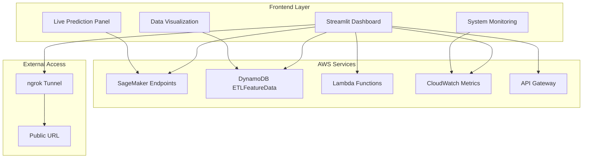

# Design Document: Cold Start Dashboard

## Overview

The Cold Start Dashboard is a production-ready Streamlit web application that provides real-time visualization and interaction with the intelligent cold start prevention system. The dashboard serves as both a demonstration tool for external examiners and an operational monitoring interface for system administrators.

The system integrates with existing AWS infrastructure including DynamoDB (ETLFeatureData table), SageMaker serverless endpoints (XGBoost and Random Forest), Lambda functions (DataAggregator, IntelligentLambdaWarmer), and CloudWatch metrics to provide comprehensive system visibility.

## Architecture

### High-Level Architecture



### Component Architecture

The dashboard follows a modular architecture with clear separation of concerns:

1. **Presentation Layer**: Streamlit components for UI rendering
2. **Service Layer**: AWS SDK integrations and data processing
3. **Data Layer**: Real-time data fetching and caching
4. **External Access Layer**: Public URL generation via ngrok

## Components and Interfaces

### 1. Main Dashboard Controller

**Purpose**: Central orchestrator for the dashboard application

**Key Functions**:
- Initialize AWS clients (DynamoDB, SageMaker, Lambda, CloudWatch)
- Manage page layout and navigation
- Handle auto-refresh cycles
- Coordinate between different dashboard sections

**Interface**:
```python
class DashboardController:
    def __init__(self):
        self.aws_clients = self._initialize_aws_clients()
        self.config = self._load_configuration()
    
    def render_dashboard(self):
        # Main dashboard rendering logic
        pass
    
    def _initialize_aws_clients(self):
        # AWS client initialization
        pass
```

### 2. Live Prediction Service

**Purpose**: Handle real-time ML predictions using SageMaker endpoints

**Key Functions**:
- Format feature vectors for SageMaker input
- Call both XGBoost and Random Forest endpoints
- Calculate ensemble predictions (70% XGBoost, 30% Random Forest)
- Handle prediction errors and fallbacks

**Interface**:
```python
class LivePredictionService:
    def __init__(self, sagemaker_client):
        self.sagemaker_client = sagemaker_client
        self.xgboost_endpoint = 'cold-start-xgboost-serverless'
        self.rf_endpoint = 'cold-start-rf-serverless'
    
    def predict_cold_start_risk(self, features: dict) -> dict:
        # Returns: {xgb_prob, rf_prob, ensemble_prob, recommendation}
        pass
    
    def format_features(self, hour, day, traffic, endpoint, new_user, mobile) -> list:
        # Convert UI inputs to ML feature vector
        pass
```

### 3. System Monitoring Service

**Purpose**: Fetch and display real-time system metrics

**Key Functions**:
- Query CloudWatch metrics for Lambda invocations
- Check API Gateway health status
- Monitor SageMaker endpoint status
- Calculate system uptime and performance metrics

**Interface**:
```python
class SystemMonitoringService:
    def __init__(self, cloudwatch_client, lambda_client):
        self.cloudwatch = cloudwatch_client
        self.lambda_client = lambda_client
    
    def get_system_health(self) -> dict:
        # Returns comprehensive system health status
        pass
    
    def get_warming_metrics(self) -> dict:
        # Returns warming system performance metrics
        pass
```

### 4. Data Visualization Service

**Purpose**: Fetch and format DynamoDB data for display

**Key Functions**:
- Query recent records from ETLFeatureData table
- Format data for Streamlit display
- Calculate statistics and trends
- Handle data refresh and caching

**Interface**:
```python
class DataVisualizationService:
    def __init__(self, dynamodb_resource):
        self.table = dynamodb_resource.Table('ETLFeatureData')
    
    def get_recent_requests(self, limit: int = 50) -> list:
        # Returns formatted recent request data
        pass
    
    def calculate_cold_start_ratio(self, data: list) -> float:
        # Calculate cold start percentage from data
        pass
```

### 5. Traffic Generation Controller

**Purpose**: Trigger and monitor traffic generation for demonstrations

**Key Functions**:
- Invoke traffic generator Lambda function
- Monitor traffic generation progress
- Update UI with generation status
- Handle concurrent generation prevention

**Interface**:
```python
class TrafficGenerationController:
    def __init__(self, lambda_client):
        self.lambda_client = lambda_client
        self.traffic_generator_function = 'TrafficGenerator'
    
    def start_traffic_generation(self) -> bool:
        # Trigger traffic generation
        pass
    
    def get_generation_status(self) -> dict:
        # Check if traffic generation is active
        pass
```

## Data Models

### Prediction Request Model
```python
@dataclass
class PredictionRequest:
    hour_of_day: int  # 0-23
    day_of_week: int  # 0-6 (Monday=0)
    traffic_intensity: float  # 0.01-2.0
    endpoint_type: str  # 'auth', 'profile', 'search'
    user_type_new: bool
    device_mobile: bool
    is_business_hours: bool  # Calculated field
```

### Prediction Response Model
```python
@dataclass
class PredictionResponse:
    xgboost_probability: float
    random_forest_probability: float
    ensemble_probability: float
    prediction_label: str  # 'cold_start' or 'warm'
    recommendation: str
    model_agreement: float
    timestamp: datetime
```

### System Health Model
```python
@dataclass
class SystemHealth:
    api_status: str  # 'healthy', 'degraded', 'down'
    sagemaker_endpoints: dict  # endpoint_name -> status
    lambda_functions: dict  # function_name -> last_invocation
    dynamodb_status: str
    recent_request_count: int
    uptime_percentage: float
```

### DynamoDB Record Model
```python
@dataclass
class DynamoDBRecord:
    timestamp: datetime
    endpoint_type: str
    cold_start_label: int  # 0 or 1
    hour_of_day: int
    traffic_intensity: float
    user_type_new: int
    device_mobile: int
    is_business_hours: int
```

## Correctness Properties

*A property is a characteristic or behavior that should hold true across all valid executions of a system-essentially, a formal statement about what the system should do. Properties serve as the bridge between human-readable specifications and machine-verifiable correctness guarantees.*

### Property Reflection

After analyzing all acceptance criteria, several properties can be consolidated to eliminate redundancy:

- Properties related to data display completeness (metrics, warming history, cost data) can be combined into comprehensive display validation properties
- Properties about calculation accuracy (cost, ROI, statistics) can be unified under mathematical correctness properties
- Properties about UI element presence can be grouped by functional area

### Core Properties

**Property 1: Prediction Input Validation**
*For any* set of prediction parameters (hour 0-23, day 0-6, traffic 0.01-2.0, endpoint type, user flags), the dashboard should generate a valid feature vector and return probability values between 0 and 1
**Validates: Requirements 1.1, 1.5**

**Property 2: Dual Endpoint Prediction**
*For any* prediction request, the system should call both XGBoost and Random Forest endpoints and return individual probabilities plus ensemble result
**Validates: Requirements 1.2**

**Property 3: Risk Threshold Warning**
*For any* prediction with ensemble probability > 0.7, the dashboard should display high-risk warning and warming recommendation
**Validates: Requirements 1.3**

**Property 4: Prediction Result Completeness**
*For any* successful prediction, the display should include XGBoost probability, Random Forest probability, ensemble probability, model agreement, and recommendation text
**Validates: Requirements 1.4**

**Property 5: System Metrics Completeness**
*For any* system monitoring request, the dashboard should display all required metrics: API health, recent request counts, SageMaker statistics, and Lambda activity
**Validates: Requirements 2.2**

**Property 6: Schedule Calculation Accuracy**
*For any* current timestamp, the next 15-minute batch processing time should be calculated as the next quarter-hour boundary
**Validates: Requirements 2.3**

**Property 7: Error Handling Display**
*For any* system error condition, the dashboard should highlight the failed component and provide diagnostic information
**Validates: Requirements 2.4**

**Property 8: Data Record Limiting**
*For any* DynamoDB query, the dashboard should return exactly the requested number of recent records (max 50) with all required fields present
**Validates: Requirements 3.1**

**Property 9: Statistical Calculation Accuracy**
*For any* dataset of DynamoDB records, cold start ratio should equal the count of records with cold_start_label=1 divided by total records
**Validates: Requirements 3.3**

**Property 10: Trend Calculation Correctness**
*For any* time series data, trend calculations should be mathematically accurate and reflect actual data patterns
**Validates: Requirements 3.4**

**Property 11: Data Display Formatting**
*For any* data record displayed, all required fields (timestamp, endpoint, cold start indicator, traffic level) should be present and properly formatted
**Validates: Requirements 3.5**

**Property 12: Traffic Generation Concurrency Control**
*For any* traffic generation request, only one generation session should be allowed to run at a time
**Validates: Requirements 4.5**

**Property 13: Traffic Generation Impact**
*For any* completed traffic generation session, the request count metrics should increase from pre-generation baseline
**Validates: Requirements 4.3**

**Property 14: Warming History Completeness**
*For any* warming history display, each event should include timestamp, target function, and success rate information
**Validates: Requirements 5.1**

**Property 15: High-Risk Warming Trigger**
*For any* prediction with probability > 0.7, a manual warming trigger option should be displayed
**Validates: Requirements 5.2**

**Property 16: Warming Result Display**
*For any* warming operation, results should include progress status and outcome for each target Lambda function
**Validates: Requirements 5.3**

**Property 17: Warming Metrics Completeness**
*For any* warming metrics request, the display should include frequency, success rates, and cost optimization statistics
**Validates: Requirements 5.4**

**Property 18: Schedule Information Display**
*For any* warming system query, the display should show next evaluation time and current strategy information
**Validates: Requirements 5.5**

**Property 19: Cost Calculation Accuracy**
*For any* usage data, cost calculations should be mathematically correct using standard AWS pricing formulas
**Validates: Requirements 6.1, 6.4**

**Property 20: Performance Comparison Accuracy**
*For any* historical performance data, before/after comparisons should accurately reflect actual system improvements
**Validates: Requirements 6.2**

**Property 21: Efficiency Calculation Correctness**
*For any* SageMaker call statistics, efficiency calculations should accurately reflect the reduction in API calls through batch processing
**Validates: Requirements 6.3**

**Property 22: Uptime Calculation Accuracy**
*For any* system health data, uptime percentages should be calculated correctly based on available/total time ratios
**Validates: Requirements 6.5**

**Property 23: Visualization Appropriateness**
*For any* data type (metrics, trends, statistics), appropriate chart or graph types should be selected for optimal data clarity
**Validates: Requirements 7.4**

**Property 24: Concurrent Access Handling**
*For any* number of simultaneous users (up to reasonable limits), the dashboard should maintain performance without degradation
**Validates: Requirements 8.3**

**Property 25: Remote Functionality Preservation**
*For any* dashboard feature accessed via public URL, full functionality should be maintained including live predictions and real-time updates
**Validates: Requirements 8.4**

## Error Handling

### Error Categories

1. **AWS Service Errors**
   - SageMaker endpoint unavailable or timeout
   - DynamoDB access denied or table not found
   - Lambda function invocation failures
   - CloudWatch metrics query failures

2. **Data Validation Errors**
   - Invalid prediction parameters
   - Malformed DynamoDB records
   - Missing required fields in API responses

3. **Network and Connectivity Errors**
   - Internet connectivity issues for external access
   - AWS service regional outages
   - API Gateway throttling or rate limiting

4. **Application Errors**
   - Streamlit session state corruption
   - Memory or performance issues under load
   - Configuration or environment variable errors

### Error Handling Strategies

1. **Graceful Degradation**: Display cached data or default values when services are unavailable
2. **User Feedback**: Clear error messages with suggested actions
3. **Retry Logic**: Automatic retries for transient failures with exponential backoff
4. **Fallback Options**: Alternative data sources or simplified functionality when primary services fail
5. **Monitoring Integration**: Log errors to CloudWatch for operational visibility

## Testing Strategy

### Dual Testing Approach

The dashboard will use both unit testing and property-based testing for comprehensive coverage:

**Unit Tests**: Verify specific examples, edge cases, and error conditions
- Test individual component functionality
- Validate error handling scenarios
- Check integration points between services
- Verify UI component rendering

**Property Tests**: Verify universal properties across all inputs
- Validate prediction calculations for any input combination
- Test data formatting and display for any dataset
- Verify mathematical calculations for any usage statistics
- Ensure system behavior consistency across different scenarios

### Property-Based Testing Configuration

- **Framework**: Hypothesis for Python property-based testing
- **Minimum Iterations**: 100 per property test
- **Test Tagging**: Each property test references its design document property
- **Tag Format**: **Feature: cold-start-dashboard, Property {number}: {property_text}**

### Testing Focus Areas

1. **ML Prediction Pipeline**: Comprehensive testing of SageMaker integration and ensemble calculations
2. **Data Processing**: Validation of DynamoDB queries, data formatting, and statistical calculations
3. **Real-time Updates**: Testing of auto-refresh mechanisms and data synchronization
4. **External Access**: Verification of public URL functionality and concurrent user handling
5. **Error Scenarios**: Comprehensive testing of failure modes and recovery mechanisms

The testing strategy ensures both concrete functionality validation through unit tests and general correctness verification through property-based testing, providing confidence in the dashboard's reliability for external examiner demonstrations.

<function_calls>
<invoke name="prework">
<parameter name="featureName">cold-start-dashboard